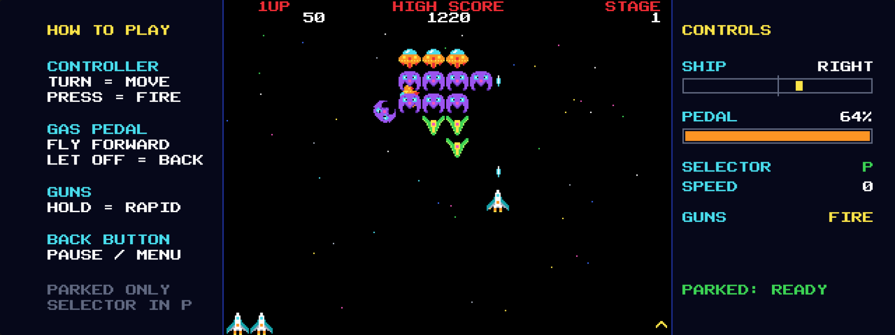
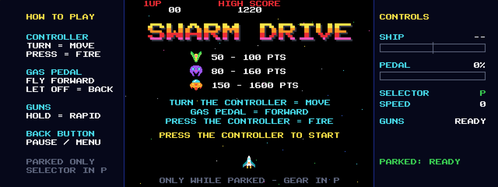
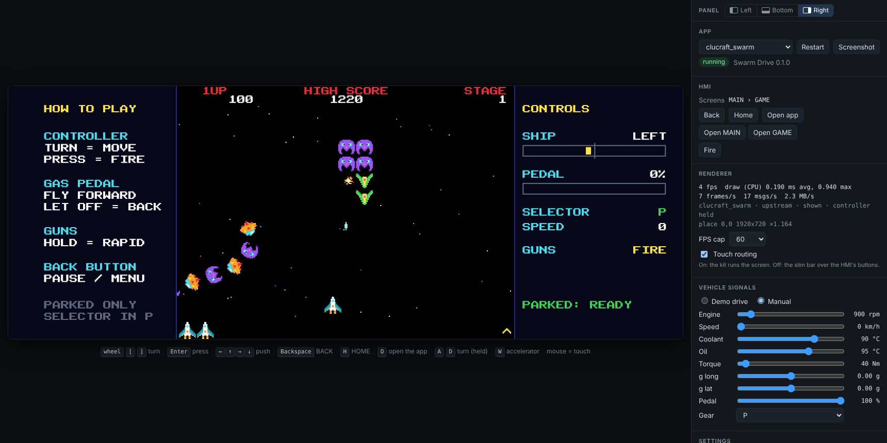

# Swarm Drive

**An 8-bit arcade shooter for the BMW iDrive 7 (MGU) head unit, played with the car's own controls while it is parked.** Turn the iDrive controller to move your ship, press it to fire, and fly the ship forward with the accelerator pedal. A swarm flies in, lines up over you and dives out of its formation to attack, in the manner of the fixed shooters of the early 1980s.



*The game in the emulator, as the head unit's 1920 x 720 screen shows it: the playfield three times its size in the middle, how to play on the left, what the car's controls are doing on the right.*

> **Status: plays in the emulator, not yet run on a car.** Everything here runs in the [idrive7-apps](https://github.com/cauliflowermossgrape/idrive7-apps) kit's emulator on a PC and passes its tests on Node 8, the Node.js the head unit runs apps on. What only a car can show is listed under [What still needs a car](#what-still-needs-a-car).

> **Parked only, and that is not a setting.** The accelerator is one of the game's controls, so the game runs only while the car reports the selector in **P** and stands still. Out of P it pauses and says so. See [Parked only](#parked-only).

> **Your head unit must be rooted.** BMW's head unit only runs apps BMW installs. Like every app built on the idrive7-apps kit, this one needs root (SSH) access to the unit, set up with the community tool [idrive7-8-ssh-root](https://github.com/cauliflowermossgrape/idrive7-8-ssh-root). Rooting can wipe the head unit's coding, delete BMW Digital Key pairings and, at worst, brick the unit: read that project's README first. This is an independent hobby project, not affiliated with or endorsed by BMW.

---

## How to play

| | |
|---|---|
| Turn the iDrive controller | the ship moves left / right, one step per click |
| Press it | fire; hold for rapid fire. Also starts a game |
| Accelerator pedal | the ship flies forward as you press, and comes back as you let off |
| BACK | the menu. The game waits; *Continue* carries on |

- **The pedal is the ship's position, not its speed.** Released, the ship sits in the back row. Pressed as far as the *Pedal travel* setting says, it is all the way forward. Half way holds it half way.
- **Two shots in the air at most**, as on the old machines. Flying forward brings you closer to the swarm, so your shots land sooner and you can fire again sooner. It also brings you closer to what is diving at you.
- **The swarm:** *Darts* (green) are the rank and file. *Claws* (purple) loop on their way down. *Wardens* (gold) take two hits and dive with Claws as escorts.
- **The capture beam:** a Warden may stop above you and throw a beam. Caught in it, your ship is taken up to the formation and you carry on with the next one. Shoot that Warden *while it dives* and the ship comes back to fly beside you: two ships, two shots at a time. Shoot it in the formation and the captured ship turns on you.
- **Bonus run** on stage 3 and every fourth stage after: forty fly through without shooting. 100 points each, 10 000 for all forty.
- **An extra ship** at 20 000 points, at 70 000, and every 70 000 after.
- **No sound:** nothing on the head unit takes an app's audio yet.



### Settings

They are rows of the app's main menu on the head unit.

| Setting | Choices (default first) |
|---|---|
| Guns | Press the controller (hold for rapid fire); Fire by themselves |
| Controller: how far a click moves the ship | Normal; A little (fine aim); Further; Far (few turns) |
| Controller direction | Normal; Reversed |
| Pedal: travel for all the way forward | Half the pedal; A quarter; The whole pedal |
| Ships | 3; 5 |
| Side panels (how to play, pedal gauge) | on; off |

### Parked only

- The game runs while the car reports the selector in **P** and is not moving (above 3 km/h counts as moving, as in the kit's other games). In R, N or D, or moving, it pauses with the reason on screen, and a press starts nothing.
- A car that reports "N or P" without telling them apart counts as parked; the speed check still applies.
- If the car sends its speed or the pedal but never the selector position, the game does not run in that car. It does not guess.
- With the engine running, pressing the accelerator in P revs the engine. The *Pedal travel* setting set to *A quarter* keeps that small. With the engine off and the ignition on, the pedal does nothing to the car; whether the car still sends its position then is one of the things to check on a car.

## Try it on a PC

You need **Node.js 18+**, **Python 3** and **git**. No car, no head unit and no BMW software are needed, and there are no npm packages to install.

```bash
git clone --recursive https://github.com/clucraft/swarm-idrive.git
```

```bash
cd swarm-idrive
```

```bash
npm run emu
```

Then open http://localhost:8077, press **Play** under *HMI* in the side panel, and click once on the screen so the keys go to it.



| Key | Does |
|---|---|
| `A` / `D` (held) | turn the iDrive controller left / right, click after click |
| `[` `]` or the mouse wheel | turn it one click |
| `Enter` | press the controller: start, fire (hold for rapid fire) |
| `W` (held) | press the accelerator; let go and it comes back up |
| `Backspace` | BACK: the menu |

- **The side panel** has the app's menu buttons (*Play*, *New game*), its settings, its log, and the vehicle signals. Under *Manual*, the *Pedal* slider is the accelerator and *Gear* is the selector: pick `D1` and the game pauses, as it would in the car.
- **Saving a file** in `apps/clucraft_swarm/` rebuilds and restarts the app while the page stays open.
- **Settings and the high score** are kept in `vendor/idrive7-apps/preview/emu/clucraft_swarm/`. Delete that folder to start over.

`npm run emu` first runs `npm run setup`, which:

- fetches the kit (the submodule `vendor/idrive7-apps`)
- applies [`patches/idrive7-apps`](patches/idrive7-apps) to it: the emulator on Windows, and the emulator's *Pedal* signal with the `A` / `D` / `W` keys
- links `apps/clucraft_swarm` into the kit
- writes a clearly marked **placeholder** for BMW's SDK, because the kit's build expects one. The emulator never loads it

### Tests

```bash
npm test
```

```bash
npm run test:node8
```

Both run without a browser or the kit. They cover the art and the font, the controls (the controller's clicks and press, the pedal, the selector, the parked check), the game with a robot at the controls (whole games, capture and rescue, the fire button), and the app on a stand-in head unit: signals in, pictures out, stopped when the car is not in P. `test:node8` runs them on Node 8.17.0, which it downloads once from nodejs.org and checks against the release's checksums.

## On the car

### Through the MGU Store

The [MGU Store](https://github.com/robertnisipeanu/mgu-store) builds apps from a repository on the head unit itself, so nothing has to be built on a PC and BMW's SDK never leaves the car.

1. In the Store, open **Settings**, choose **Add source** and enter `clucraft/swarm-idrive`. Pick the branch **main**.
2. Install **Swarm Drive** from that source.

- The app asks for the kit's GPU renderer (`idrive7-renderd`) and its controller gate (`mgu-inputgate`). Both come from the [idrive7-apps](https://github.com/cauliflowermossgrape/idrive7-apps) source, so have that source added too.
- A build on the head unit needs the Store's Python tool, which the Store installs with its updater.
- The repository is laid out for this: [`mgu-repo.json`](mgu-repo.json) names the build, and [`kit/`](kit) is the part of the idrive7-apps kit the build reads, copied in as plain files (see [Why there are two copies of the kit](#why-there-are-two-copies-of-the-kit)).

### With the kit's installer over SSH

1. Get BMW's app SDK from your own unit into `vendor/idrive7-apps/oap-sdk/`, as the [idrive7-apps README](https://github.com/cauliflowermossgrape/idrive7-apps#31-get-the-sdk-from-your-unit) describes. It replaces the placeholder.
2. Build the package:

   ```bash
   npm run build:car
   ```

   This writes `dist/clucraft_swarm@<version>.mgu`. It contains BMW's SDK: keep it for your own car and never publish it.
3. Install it with the kit's installer in `vendor/idrive7-apps` (`python3 kit/tools/make_kit.py clucraft_swarm`, then `deploy/push-to-car.sh` or `deploy\push-to-car.ps1`), as its README describes. Run its `check` first.

## What still needs a car

- **The pedal's signal.** The app reads `AcceleratorPedal.AngleAcceleratorPedal` at 0.025 % a step, the value the kit's Live Data app uses and marks as its best guess. The *PEDAL* gauge on the game screen shows what arrives; if full travel doesn't read near 100 %, the scaling needs a look.
- **The pedal with the engine off.** Whether the car sends the pedal's position with only the ignition on.
- **The selector.** Whether the car reports P on `statusGearboxDrive` or `DataPowerTrain2` as soon as the app starts. If the title screen says *Waiting for the gear selector*, move the selector out of P and back once and note it.
- **The controller.** That the controller gate hands the knob to the game, and which way round it counts (there is a *Controller direction* setting).
- **Speed and smoothness.** On a PC under Node 8 a frame of the game takes about 0.2 ms. The head unit's processor is several times slower, which still leaves room, but only the car's log tells (`loop GAME: ... ms per frame`).

The app's log (`clucraft_swarm.log` in its data folder on the head unit) names each of these as it comes alive: `pedal: live`, `selector (gearbox): P`, `controller: live`.

## How it works

```
 apps/clucraft_swarm/
   main.js       the screens, the frame clock, the signals, the parked check, the high score
     ├─ controls.js   the controller's clicks and press, the pedal, the selector -> x, y, fire, "parked"
     ├─ game.js       the game: knows nothing about the car, steps 60 times a second, draws itself
     │    ├─ paths.js     how the swarm flies: routes as lists of straights and arcs
     │    ├─ sprites.js   the pixel art, turned in 22.5 degree steps for flying
     │    └─ gfx.js       a 320 x 240 framebuffer, sprites and the 8 x 8 font
     └─ panels.js     the two side panels
        │
        ▼  one 320 x 240 pixel image a frame
 the kit's GPU renderer (mgu-renderd)  ──▶  shown 3 x 3 on the 1920 x 720 display
```

- **The picture is drawn pixel by pixel in JavaScript** into a 320 x 240 framebuffer and handed to the kit's GPU renderer as one image, which shows it at a whole multiple of its size. That is what keeps every pixel square and sharp. The kit's Doom app works the same way.
- **Everything on screen is original to this game:** the ships, the font, the name. It follows the genre, not any one machine's art.
- **The game itself is plain JavaScript without the head unit in it,** so the tests can play whole games in a few seconds, and the same seed with the same inputs always gives the same game.

### Why there are two copies of the kit

- **`kit/`** at the repository root is the part of idrive7-apps that builds an app: `build.py`, the runtime it packs into the app, the permissions template. The MGU Store downloads a repository without its submodules and builds on the head unit without a network, so these have to be plain files here. [`kit/UPSTREAM.json`](kit/UPSTREAM.json) names the commit they are from.
- **`vendor/idrive7-apps`** is the whole kit as a submodule, for the emulator and the SSH installer.
- `node tools/sync-kit.js` copies the first from the second after the submodule moves to a new commit; `npm test` fails when they differ.

## Repository layout

```
apps/clucraft_swarm/   the app: app.json, main.js, game.js, controls.js, paths.js, sprites.js,
                       gfx.js, panels.js, icon.png
kit/                   the kit's build files for the MGU Store (a copy; see above)
mgu-repo.json          tells the MGU Store how to build the app
patches/idrive7-apps/  the emulator on Windows; the emulator's Pedal signal and play keys
test/run.js            the tests (Node 8 and current)
tools/                 setup.js, emu.js, build-car.js, sync-kit.js, make-icon.js, node8.js
docs/                  screenshots
vendor/idrive7-apps    submodule: the app kit, its emulator and installer
```

## Licence

MIT. See [LICENSE](LICENSE) and [NOTICE](NOTICE).

- `kit/` is a copy of part of [idrive7-apps](https://github.com/cauliflowermossgrape/idrive7-apps), MIT, with its own [licence](kit/LICENSE); the fonts in `kit/runtime/fonts` are under the SIL Open Font License (the files beside them).
- The kit's GPU renderer and the emulator's draw engine are GPL-3.0-or-later. They are not in this repository's own files: they are in the submodule and run as their own programs.
- BMW's app SDK is BMW's. It is not in this repository and may not be published.
